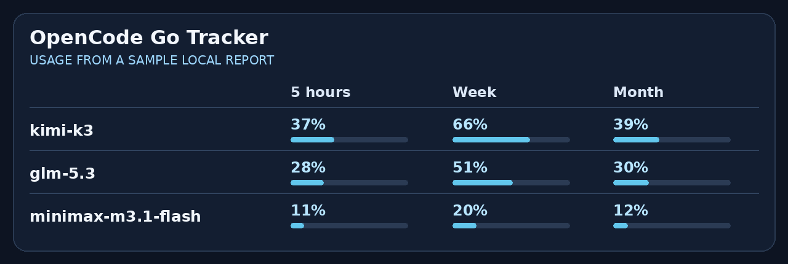
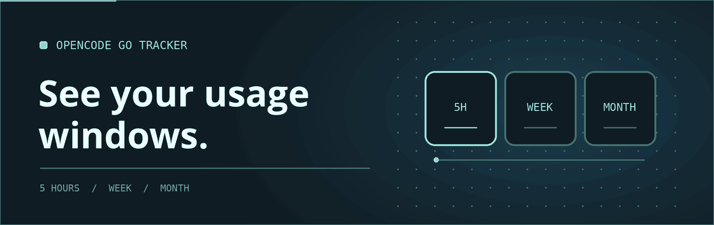

<div align="center">

<h1>OpenCode Go Tracker</h1>

<p><strong>See your 5-hour, weekly and monthly OpenCode Go usage in a local dashboard.</strong></p>

<p><strong><a href="#quick-start">📊 Run the dashboard</a></strong> · <a href="#go-windows-5h--week--month">⏱️ How usage windows work</a> · <a href="#command-reference">⌨️ Commands</a></p>

</div>

## 📊 Sample usage report

<p align="center">
  <a href="usage-sample.png"></a>
</p>

<details>
<summary>Project illustration</summary>

<picture>
  <source media="(prefers-reduced-motion: reduce)" srcset="readme-hero.png" />
  
</picture>

</details>

<p align="center"><sub>The tracker calculates these windows using synthetic requests.</sub></p>

Local tracker for **OpenCode Go / Console**. Three ways to use it, one shared library:

- **CLI** (`tracker.py` / `opencode-tracker`) — CSV merge, logger, proxy, session import, reports, forecasts, plans, anomalies, attribution, scheduled reports.
- **Web dashboard** (`app.py` + `web/index.html`) — drag-drop merger, live logger, report filters, live windows, and an **Insights** tab with charts, forecast, plan comparison, anomalies, and attribution.
- **Standalone page** (`Go-Tracker.html`) — no server, no install: open the file and drop CSVs.

No data leaves your device except the Inference API calls you make and the public model-list request used by `sync-limits`.

<a name="what-it-does"></a>

## 🧰 What it does

| Console area | What it shows | This tracker |
|---|---|---|
| **Activity → Usage** | Cost by day, model, person; **Export usage** CSV for 7/30/90 days | **CSV merger** consumes those exports |
| **Inference API → Cost** | Every response returns `usage.cost`, `opencode.billing_source`, `list_cost`, `allowance`, `tokens{...}` | **Logger** parses and stores every field; **proxy** captures real traffic |
| **Go** | Per-model monthly limits; 5h = 20%, weekly = 50%, monthly = 100% | **Windows report** computes live 5h/week/month usage |
| **Go model list API** | `GET /inference/go/v1/models` with `go.monthly_usage` | **`sync-limits`** refreshes the local limit table |
| **OpenCode sessions** | Local `opencode.db` holds session cost/tokens | **`import-sessions`** imports metadata for attribution |
| **Budgets → What counts** | Paid & Go extra usage count; free & Go-within-plan don't | Merger's `--billable-only`, logger's `billing_source` |

Go window semantics come from <https://opencode.ai/docs/go#usage-limits>:

- **5-hour limit = 20%** of the model's monthly allowance. The window starts when you first use your allowance and lasts five hours.
- **Weekly limit = 50%**, resetting **Monday 00:00 UTC**.
- **Monthly limit = 100%**, resetting when a new paid period starts. The local tracker cannot see your subscription anniversary, so the reset day is configurable (`--period-start-day`, default 1).

`allowance` is what counts toward Go limits. `cost` is 0 while usage stays inside the plan; it becomes non-zero (and `billing_source=balance`) after Extra Usage kicks in.

---

<a name="quick-start"></a>

## 🚀 Quick start

```powershell
git clone https://github.com/Avithegod2010/opencode-go-tracker.git
cd opencode-go-tracker

# Editable install (CLI + library). Flask and requests come with it.
pip install -e ".[dev]"

# Optional: configure a key for live logging
copy .env.example .env
# edit .env: OPENCODE_API_KEY=oc_sk_... and OPENCODE_BASE_URL
#   Personal key: Console → Account → Personal API keys → Add API key
#   Service account: Console → Settings → Service accounts → Add API Key
#   Permission needed: Restricted → Models: Request
#   Base URL: https://opencode.ai/inference/go  (Go)  or  https://opencode.ai/inference (paid balance)

# Dashboard
python app.py                 # http://localhost:8000
# or
opencode-tracker web --port 8000

# Or run everything: proxy + dashboard + periodic limit sync
opencode-tracker daemon --plan go --period-start-day 1 --report-every 24
#   proxy:      http://127.0.0.1:8787
#   dashboard:  http://127.0.0.1:8000
#   reports:    ./reports/
```

### Dashboard tabs

- **A. CSV Merger** — drop `usage_7d.csv` + `usage_30d.csv` (+ `90d`), pick a plan, toggle billable-only/dedupe, **Merge** → per-model table plus **totals.csv** and **detailed.csv** downloads.
- **B. Logger** — paste an `oc_sk_...` key or choose a profile, choose Base URL, model and API family, send a message → shows `billing_source`, `cost`, `allowance`, tokens, and writes SQLite + CSV. **Check key** verifies it against `/v1/models`.
- **Report** — filtered per-model/billing totals, current-period totals, daily trend, recent requests, plan history, session import, and the live **5h / week / month** window table. Set the **period start day** to your subscription anniversary.
- **Insights** — cost/request/cache KPIs, stacked cost chart, model mix, burn-rate forecast, Go/Plus/Teams comparison, anomalies, and attribution by project/session/member/profile/model.
- **Help** — docs links and billing/Go/budget notes.

Keys typed in the browser persist in `localStorage` only on your device. Prefer `.env` for CLI use.

### Standalone page

Open `Go-Tracker.html` directly (double-click). Drop the same export CSVs; everything runs in the browser. The root `index.html` is a small landing page linking both surfaces.

---

## Live capture

### Reverse proxy (recommended)

`opencode-tracker proxy` is a local OpenAI-compatible reverse proxy. Point any client that supports a custom base URL at it; the proxy forwards to OpenCode, streams the response back, and records every inference request.

```powershell
opencode-tracker proxy --port 8787 --plan go --period-start-day 1
# Go base URL for the client:
#   http://127.0.0.1:8787/inference/go
# Paid balance:
#   http://127.0.0.1:8787/inference
```

- The client's `Authorization` header is forwarded; the proxy does not need or store a key.
- SSE streams are relayed chunk by chunk and parsed for the final usage payload.
- `x-opencode-session` is captured automatically; `x-opencode-project` (or `--project`) sets the project label.
- Non-inference paths such as `/v1/models` are forwarded but not logged.
- Binds `127.0.0.1` by default. Do not expose it to the internet.

Quick check with curl:

```powershell
curl -X POST "http://127.0.0.1:8787/inference/go/openai/v1/chat/completions" `
  -H "Authorization: Bearer oc_sk_..." -H "Content-Type: application/json" `
  -d '{"model":"kimi-k3","messages":[{"role":"user","content":"hi"}]}'
```

### Import OpenCode sessions

OpenCode keeps a local `opencode.db` with session cost/tokens. The importer reads **only metadata**: session id, project, title, model, cost, tokens, and timestamps. It never reads prompts, message content, accounts, or credentials.

```powershell
opencode-tracker import-sessions --dry-run
opencode-tracker import-sessions --limit 5
opencode-tracker import-sessions --since 2026-11-01 --no-titles
```

- Auto-detects `~/.local/share/opencode/opencode.db` (and the Windows AppData locations); override with `--opencode-db` or `OPENCODE_CLIENT_DB`.
- Re-imports are idempotent (deduplicated by message id).
- Per-message usage is reconciled against the session aggregate so totals match.
- Session data has no `opencode.allowance`, so imported rows carry cost/tokens but not Go allowance. Use the proxy for live limit percentages.
- The dashboard Report tab has an **Import OpenCode sessions** button.

### Profiles and key checks

Profiles keep base URL, plan, project, member, and the **name of an environment variable** — never the key:

```powershell
opencode-tracker profile add work --base-url https://opencode.ai/inference/go `
  --plan go --key-env OPENCODE_KEY_WORK --project tracker --member alice
opencode-tracker profile list
opencode-tracker profile check work
opencode-tracker log --profile work --model kimi-k3 --message "Hi"
```

Resolution order: explicit `--api-key` → the profile's `key_env` → `OPENCODE_PROFILE_<NAME>_KEY` → `OPENCODE_API_KEY`.

```powershell
opencode-tracker key-check              # validates the env key against /v1/models
opencode-tracker key-check --profile work
```

`key-check` reports HTTP status, model count, Go model count, plans seen, and a redacted key prefix.

### Watch and daemon

```powershell
opencode-tracker watch --plan go --interval 5   # live terminal window table
opencode-tracker watch --once                    # print once and exit

opencode-tracker daemon --plan go --period-start-day 1 `
  --sync-interval 60 --import-interval 0 --report-every 24
```

`daemon` runs the proxy and dashboard together, refreshes limits on an interval, optionally imports sessions, and writes scheduled reports.

---

## A. CSV merger

**Where to get CSVs:** Console → **Activity → Usage** → **Export usage** → **7 / 30 / 90 days**. The exports overlap, so the merger deduplicates.

```powershell
# Merge everything in a folder
opencode-tracker csv-merge "exports/*.csv" -o totals.csv --plan go

# Explicit files
opencode-tracker csv-merge exports/usage_7d.csv exports/usage_30d.csv exports/usage_90d.csv -o totals.csv

# Mirror budget spend: only Paid + Go extra usage (exclude Free & Go within plan)
opencode-tracker csv-merge "exports/*.csv" -o totals_billable.csv --billable-only

# Other plans / raw sum
opencode-tracker csv-merge "exports/*.csv" --plan go_plus
opencode-tracker csv-merge "exports/*.csv" --plan go_teams
opencode-tracker csv-merge "exports/*.csv" -o raw.csv --no-dedupe
```

`python tracker.py csv-merge ...` is equivalent.

**Output**

- Console table sorted by cost, with monthly limit, `% used`, and the 5h/week limit values when `--plan` is given.
- `totals.csv` — `model, cost, billable_cost, list_cost, allowance_sum, rows, monthly_limit, pct_month, 5h_limit, weekly_limit`.
- `totals_detailed.csv` — the deduped rows used for the sums (audit trail).
- Footer: shown totals, billable totals, allowance, billing-source breakdown, top persons, date range.
- With `--billable-only`, the totals describe the **filtered rows** you are looking at; the unfiltered totals are printed underneath for context.

**Column auto-detection** is case/spacing-insensitive. Recognized: `date/day/timestamp`, `model/model_id`, `person/member/user/email`, `cost/amount/usd`, `billing_source/source`, `allowance`, `list_cost`, and token columns.

**Dedupe** uses `(date, model, person, billing_source, cost, allowance)`. Repeats are dropped only when they come from a **different** file, so overlapping 7/30/90 exports collapse while genuinely distinct rows inside one export survive. Disable with `--no-dedupe`.

**Billable logic (Budgets → What counts):**

| Spend | Counts? | `billing_source` |
|---|---|---|
| Paid Console models | **Yes** | `balance` |
| Your own provider (BYOK) with a price | **Yes** | `byok` |
| Free models | **No** | `free` |
| Go within plan | **No** | `go` / `go-plus` |
| Go extra usage from credits | **Yes** | `balance` (after the limit) |

Sample exports live in `examples/`:

```powershell
opencode-tracker csv-merge "examples/*.csv" -o examples_totals.csv --plan go
```

---

## B. Logger (Inference API → SQLite/CSV)

Every inference response reports cost fields (see <https://opencode.ai/v2/docs/console/api/inference/>):

```json
"usage": {
  "prompt_tokens": 1200,
  "completion_tokens": 300,
  "cost": 0.00412,
  "opencode": {
    "billing_source": "balance",
    "list_cost": 0.00412,
    "allowance": 0.003,
    "estimated": true,
    "tokens": {"input":1200,"output":300,"reasoning":120,"cache_read":8000,"cache_write_5m":0,"cache_write_1h":0}
  }
}
```

The logger supports all four API families:

- OpenAI Chat Completions `/openai/v1/chat/completions`
- OpenAI Responses `/openai/v1/responses`
- Anthropic Messages `/anthropic/v1/messages`
- Gemini `/google/v1beta/models/<model>:generateContent`

Streaming is parsed from the final usage event (`stream_options.include_usage` for Chat Completions, `response.completed` for Responses, `message_delta` for Messages, last chunk for Gemini).

### Single call → DB + CSV

```powershell
opencode-tracker log --model kimi-k3 --message "Say hi in one sentence."
opencode-tracker log --model glm-5.3-flash --message "Hi" --base-url https://opencode.ai/inference/go
opencode-tracker log --model claude-haiku-5-5 --api anthropic --message "Hi"
opencode-tracker log --model gpt-6-luna --api responses --message "Hi"
opencode-tracker log --model gemini-4-argon --api gemini --message "Hi"
opencode-tracker log --model kimi-k3 --message "Stream hello" --stream
opencode-tracker log --model kimi-k3 --message "Hi" --json-out response.json
```

**SQLite** (`opencode_usage.db`) table `requests`:

| Column | Meaning |
|---|---|
| `timestamp` | UTC ISO |
| `model`, `provider`, `endpoint` | request metadata |
| `billing_source` | `free \| balance \| go \| go-plus \| byok` |
| `cost` | charged amount (0 for free / Go within plan) |
| `list_cost` | retail price |
| `allowance` | Go dollars consumed |
| `input_tokens`, `output_tokens`, `reasoning_tokens`, `cache_read`, `cache_write_5m/1h` | from `opencode.tokens` |
| `prompt_tokens`, `completion_tokens` | raw `usage.*` |
| `estimated` | BYOK estimate flag |
| `status` | `ok \| error \| 401_unauthorized \| 402_insufficient_funds \| 403_forbidden \| 429_budget_exceeded` |
| `raw_json` | usage blob for audit |

**CSV** (`usage_log.csv`) gets the same columns, appended per request.

**Keys & errors:** send `Authorization: Bearer oc_sk_...`. A key needs **Models: Request**. HTTP `401` = invalid/expired/revoked key; `402` = balance zero; `403` = key lacks permission or the model is blocked; `429` = budget policy hit.

### Programmatic use

```python
from opencode_tracker.logger import OpencodeLogger, parse_usage

logger = OpencodeLogger(
    db_path="opencode_usage.db",
    csv_path="usage_log.csv",
    api_key="oc_sk_...",
    base_url="https://opencode.ai/inference/go",
)

resp = logger.chat_completions(model="kimi-k3", messages=[{"role": "user", "content": "hi"}])
parsed = parse_usage(resp)  # billing_source, cost, allowance, tokens...
```

For your own HTTP calls, wrap them with `parse_usage(response_json)` and insert via `opencode_tracker.db.insert_request`.

---

<a name="go-windows-5h--week--month"></a>

## ⏱️ Go windows (5h / week / month)

```powershell
opencode-tracker report --plan go
opencode-tracker report --plan go_plus --period-start-day 15
opencode-tracker report --plan go_teams --db opencode_usage.db
```

The report prints lifetime per-model totals, then a live window table:

```
Model                        5h used/limit          Week used/limit         Month used/limit  Status
kimi-k3                   $2.00/$3 (66.7%)      $3.00/$8 (40.0%)      $9.00/$15 (60.0%)    warm
```

- **5h** is anchored at the first Go request after the previous window ended — not a naive "last 5 hours".
- **Week** starts Monday 00:00 UTC.
- **Month** starts on `--period-start-day` (or `OPENCODE_PERIOD_START_DAY`), default 1. Set it to your subscription anniversary for accurate monthly percentages.
- Only rows with `allowance > 0` count. Balance/free rows are ignored.
- `status` is `ok` (<50%), `warm` (50–80%), `near` (80–100%), `over` (≥100%), or `no-limit`.

The web Report tab shows the same table and lets you change the period start day without restarting.

> CSV exports are daily totals, so they cannot resolve the 5-hour window. The standalone page therefore shows the **current month** and **last 7 days** relative to the newest date in the file and labels 5h as unavailable.

---

## Insights, forecasts, and planning

All analytics honor the same filters: `--from`, `--to`, `--model`, `--member`, `--profile`, `--project`, `--session`, `--source`, `--status`.

### Filters and report

```powershell
opencode-tracker report --plan go --from 2026-11-01 --to 2026-11-30 --profile work
opencode-tracker report --plan go --project tracker --member alice
```

The Report tab exposes the same filters as date inputs and dropdowns (options come from the DB).

### Burn-rate forecast

```powershell
opencode-tracker forecast --plan go --period-start-day 1
```

Projects the current period from elapsed burn, estimates days until each model limit, and flags `warm` / `risk` / `over`. Confidence is low before a full day of data. The Insights tab shows the same table.

### Plan comparison

```powershell
opencode-tracker plan-sim --period-start-day 1
```

Compares current allowance usage against Go / Go Plus / Go Teams per-model limits: models over, allowance overage, coverage, and whether the plan fits. It is allowance-based coverage, not a token-price quote.

### Plan history

```powershell
opencode-tracker plan set go --from 2026-10-01
opencode-tracker plan set go_plus --from 2026-11-15 --note "upgrade"
opencode-tracker plan list
opencode-tracker plan current
```

Each logged/proxied request stores the active plan, and windows group by `(model, plan)`, so old percentages stay correct after an upgrade. The Report tab has a **Save plan** button.

### Anomalies

```powershell
opencode-tracker anomalies --days 30 --baseline-days 14 --threshold 2
```

Flags days whose cost or allowance exceeds `mean + threshold × stddev` over the prior baseline, and names the top models for that day.

### Attribution

```powershell
opencode-tracker attribution --by project
opencode-tracker attribution --by session --profile work
```

Groups cost and allowance by project, session (with session title), member, profile, or model, including share percentages.

### Scheduled reports

```powershell
opencode-tracker export-report --out reports/daily.html --format html --plan go
opencode-tracker export-report --out reports/daily.json --format json
opencode-tracker daemon --report-every 24 --report-dir reports --report-format html
```

The standalone report bundles KPIs, daily/model tables, forecast, plan comparison, project attribution, and anomalies. It uses inline CSS, no external assets, and escapes all data.

---

## Limit sync (`sync-limits`)

The live Go model list is documented at <https://opencode.ai/v2/docs/console/api/models>:

```powershell
opencode-tracker sync-limits
# GET https://opencode.ai/inference/go/v1/models
# caches data[].go.monthly_usage -> go_limits_cache.json
```

- Works without a key (public Go catalog). With a Go key it returns the workspace's own catalog.
- Cached values take precedence over the built-in table, so limits stay current as plans change.
- Example: the live list currently reports **GLM-5.3 at $500/$1000/$505** (a temporary higher allowance), while the static fallback still has the normal $15/$120/$20.
- The cache file is gitignored; delete it to fall back to the built-in table.
- Web equivalent: `POST /api/sync-limits` with `{}` (or `{"api_key": "..."}`).

**About usage polling:** Console documents a **Usage: Read** permission, but the public API overview lists only Models, Inference, and Providers — there is no documented usage endpoint to poll. This tracker therefore records usage from inference responses (the logger) and imports the official CSV exports. The `sync-limits` command uses the one documented endpoint that carries usage limits.

---

<a name="command-reference"></a>

## ⌨️ Command reference

| Command | Purpose |
|---|---|
| `csv-merge` | Merge Console export CSVs into per-model totals |
| `log` | One manual inference call → DB/CSV |
| `proxy` | Local reverse proxy that logs every inference request |
| `import-sessions` | Import cost/tokens/session metadata from OpenCode |
| `watch` | Live terminal 5h/week/month view |
| `daemon` | Proxy + dashboard + periodic sync/import/report |
| `report` | Filtered totals, daily, recent, and Go windows |
| `forecast` | Projected period usage and days-to-limit |
| `plan-sim` | Compare Go / Plus / Teams coverage |
| `plan set/list/current` | Track the active plan over time |
| `anomalies` | Flag unusual daily cost/allowance |
| `attribution` | Cost by project/session/member/profile/model |
| `export-report` | Standalone HTML/JSON report |
| `profile add/list/remove/check` | Env-only key profiles |
| `key-check` | Validate a key against `/v1/models` |
| `sync-limits` | Refresh the Go limit cache |
| `web` | Launch the dashboard (from a checkout) |
| `init-db` | Create the SQLite DB |

## Project layout

```
.
├── app.py                      # Flask server (serves web/ + /api/*)
├── web/index.html              # Dashboard (Merger, Logger, Report, Insights, Help)
├── index.html                  # Landing page linking the two UIs
├── Go-Tracker.html             # Standalone, no-backend analysis page
├── tracker.py                  # Thin CLI shim (kept for `python tracker.py ...`)
├── src/opencode_tracker/
│   ├── cli.py                  # CLI implementation + `opencode-tracker` entry point
│   ├── csv_merger.py           # A. merger
│   ├── logger.py               # B. inference logger + parse_usage + retries
│   ├── proxy.py                # reverse proxy (JSON + SSE)
│   ├── importer.py             # OpenCode session metadata import
│   ├── profiles.py             # env-only key profiles
│   ├── preflight.py            # key check against /v1/models
│   ├── db.py                   # SQLite v2 schema, filters, plans, profiles
│   ├── windows.py              # 5h / week / month computation
│   ├── forecast.py             # burn-rate projection
│   ├── simulator.py            # Go / Plus / Teams comparison
│   ├── analytics.py            # KPIs and chart series
│   ├── anomalies.py            # day-level anomaly detection
│   ├── attribution.py          # project/session/member/profile/model totals
│   ├── report_html.py          # standalone HTML/JSON reports
│   ├── daemon.py               # proxy + dashboard + periodic tasks
│   ├── watch.py                # live terminal window table
│   └── go_limits.py            # limits table + sync cache
├── tests/                      # pytest suite (118 tests)
├── examples/                   # sample usage CSVs
├── .env.example
├── pyproject.toml
├── SECURITY.md
└── README.md
```

## Tests

```powershell
pip install -e ".[dev]"
python -m pytest -q
```

Coverage: CSV dedupe/totals/billable filtering, window math (5h anchoring, Monday reset, period anniversary, future rows, plan split), usage parsing for all four API families, logger retries/status/latency and current-plan capture, proxy JSON/SSE/error forwarding, session import (v1/v2, adjustment, dedupe, no content/credentials), profiles and key checks, filters, analytics, forecast, plan simulator/history, anomalies, attribution, HTML/JSON reports, and the HTTP/security surface.

---

## Troubleshooting

- **No CSVs matched** → quote the glob: `"exports/*.csv"` (Windows shell expansion differs).
- **Missing model/cost column** → check the Console export header row; the merger prints detected columns.
- **Go % looks too high or splits by plan** → windows group by the plan recorded on each request. Set the plan history (`plan set`) before logging; legacy rows use the selected plan.
- **Windows show 0** → allowance is only present on live Inference responses. Run the proxy or log a Go request; session imports carry cost/tokens but not allowance.
- **No allowance in CSV** → exports may only carry `cost`; the merger falls back to cost for the summary percentage.
- **Proxy logs nothing** → confirm the client base URL is `http://127.0.0.1:8787/inference/go` (or `/inference`), and that the path contains a known inference endpoint. `/v1/models` is forwarded but intentionally not logged.
- **`import-sessions` finds nothing** → pass `--opencode-db "C:\Users\...\.local\share\opencode\opencode.db"` or set `OPENCODE_CLIENT_DB`. The importer reads metadata only and does not need a key.
- **`export-report` is empty** → reports use the same filters and plan; check `--from/--to` and that the DB has rows.
- **`sync-limits` fails** → check network access to `https://opencode.ai/inference/go/v1/models`; clear `go_limits_cache.json` and retry.
- **HTTP 401** → key invalid/expired/revoked.
- **HTTP 402** → balance zero; add credits or enable Auto-recharge.
- **HTTP 403** → key lacks **Models: Request**, or the model is blocked by workspace privacy settings.
- **HTTP 429** → budget policy hit; raise it in Controls or check Activity → Logs.
- **`web` says app.py not found** → the installed CLI can run the library, but the dashboard needs the repository checkout (`python app.py`).

<a name="privacy"></a>

## 🔒 Privacy

`.env`, `*.db`, `*.csv`, `reports/`, `go_limits_cache.json`, and `.pytest_cache/` are local and gitignored. No telemetry. Requests go only to `https://opencode.ai` and the base URL you configure. Session imports read usage metadata from OpenCode's local DB; they do not read prompts, accounts, or credentials.

## Security

See [SECURITY.md](SECURITY.md) for the full policy. Defaults are deliberately local:

- Dashboard and proxy bind `127.0.0.1`; do not expose either to the internet.
- The server-side `OPENCODE_API_KEY` and profile keys are only used for **loopback** requests. LAN clients must send their own key.
- The web logger only forwards to `opencode.ai` (override hosts with `OPENCODE_ALLOWED_BASE_HOSTS`), blocking SSRF and key exfiltration.
- `Host`/`Origin` validation blocks DNS rebinding and cross-site POSTs. Extra hostnames can be allowed with `OPENCODE_ALLOWED_HOSTS`.
- Profiles store env variable names, not keys. Session import never reads `credential`, `account`, or message content.
- CSV/API values are HTML-escaped in the dashboard and reports; a strict Content-Security-Policy limits connections to the same origin.
- Browser-saved keys live in `localStorage` only when you tick “save key”.

## License

MIT — see [LICENSE](LICENSE).
